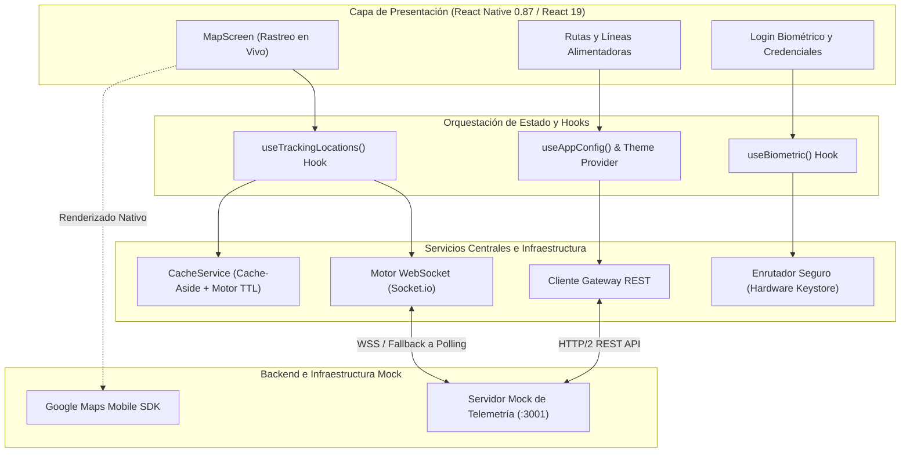
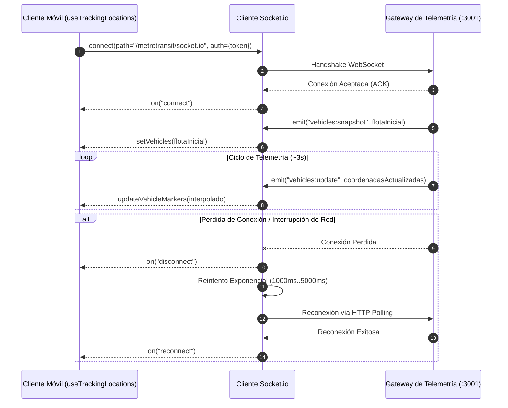
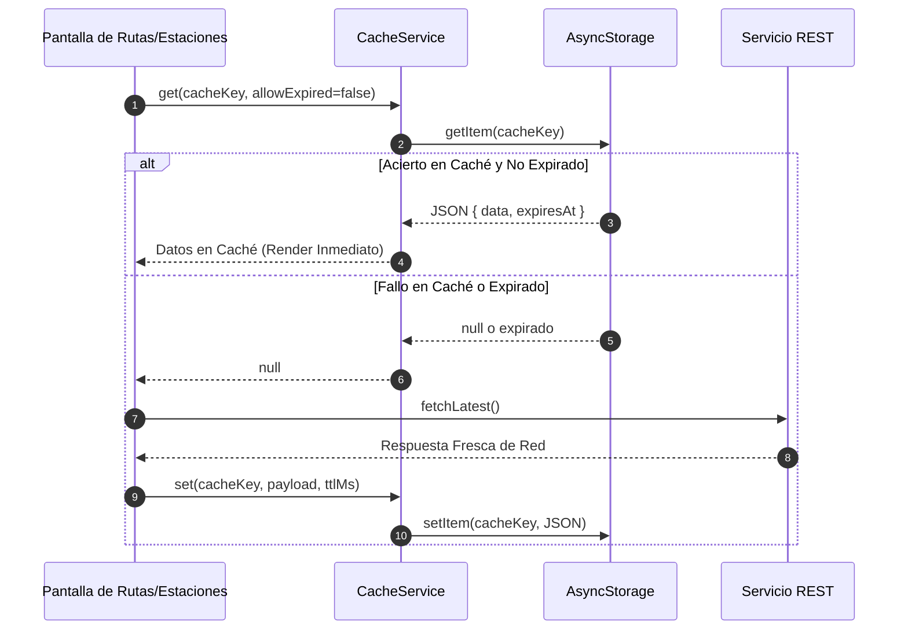

<div align="right">
  <strong>Language / Idioma:</strong>&nbsp;
  <a href="./README.md"></a>&nbsp;
  <a href="./README.es.md"></a>
</div>

# MetroTransit Mobile — Telemetría Inteligente de Flotas y Tránsito

> Cliente móvil en producción desarrollado en React Native 0.87 (React 19 / TypeScript) diseñado para telemetría vehicular metropolitana en tiempo real, renderizado geoespacial de alta frecuencia y seguridad biométrica respaldada por hardware.

---

## Resumen Técnico y Problema Resuelto

Las redes de transporte urbano requieren aplicaciones móviles capaces de procesar flujos de telemetría de alta frecuencia sin degradar la batería del dispositivo, sin provocar caídas de cuadros en la interfaz (jank) y garantizando cero exposición de credenciales en entornos vulnerados.

**MetroTransit** demuestra una arquitectura móvil empresarial que resuelve estos desafíos mediante:
1. **Streaming de Telemetría de Baja Latencia:** Canal persistente WebSocket (`socket.io-client`) con políticas de reconexión exponencial y degradación transparente de transporte (`websocket` $\to$ `polling`) para seguimiento vehicular continuo.
2. **Almacenamiento Criptográfico por Niveles:** Aislamiento de credenciales mediante Keystore / iOS Keychain (`react-native-keychain` bajo políticas `WHEN_UNLOCKED`), complementado con almacenamiento local no sensible (`AsyncStorage`).
3. **Motor de Caché Offline (Cache-Aside):** Capa centralizada de caché con expiración por tiempo (TTL) y recuperación automática ante datos corruptos.
4. **UI Reactiva y Desacoplada:** Separación estricta entre componentes de presentación y orquestación de negocio mediante Custom Hooks especializados.

---

## Diagrama de Arquitectura del Sistema



---

## Flujos Críticos de Secuencia

### 1. Telemetría Vehicular en Tiempo Real (WebSockets)


### 2. Estrategia Cache-Aside con Expiración por Tiempo (TTL)


---

## Estructura del Repositorio

```
portfolio-demo-metrotransit-mobile/
├── android/                   # Proyecto nativo Android (Kotlin / Gradle)
├── ios/                       # Proyecto nativo iOS (Swift / CocoaPods)
├── mock-server/               # Servidor local mock de API REST y WebSockets
│   ├── Dockerfile
│   ├── package.json
│   └── server.js              # Transmisor de coordenadas GPS en vivo
├── src/
│   ├── assets/                # Iconografía y SVGs modernos Slate Tech
│   ├── components/            # Componentes reutilizables (Mapa, Marcadores, Encabezados)
│   ├── config/                # Contexto global AppConfigContext
│   ├── helpers/               # Almacenamiento seguro, orientación, formato y endpoints
│   ├── hooks/                 # Custom hooks desacoplados (useLocation, useAppConfig)
│   ├── navigation/            # Navegación y pantallas protegidas (ProtectedScreen)
│   ├── screens/               # Módulos de pantallas (Mapa, Login, Rutas, Soporte, Splash)
│   ├── shared/                # Servicios de caché, claves y sockets de rastreo
│   └── types/                 # Interfaces TypeScript tipadas
├── docs/
│   ├── ARCHITECTURE.md        # Especificación técnica profunda de arquitectura
│   └── SECURITY.md            # Reporte de sanitización y cumplimiento OWASP MASVS
├── docker-compose.yml         # Backend simulado listo con un solo comando
├── .env.example               # Plantilla de variables de entorno documentadas
├── package.json
└── tsconfig.json
```

---

## Variables de Entorno

Copia el archivo `.env.example` a `.env` antes de ejecutar el proyecto:

```bash
cp .env.example .env
```

| Variable | Descripción | Valor Predeterminado / Demo |
| :--- | :--- | :--- |
| `API_BASE_URL` | URL base para los servicios REST de MetroTransit | `http://localhost:3001/v1/` |
| `API_MESSAGES_URL` | Endpoint para notificaciones operativas y avisos | `http://localhost:3001/v1/messages/` |
| `BASE_URL` | URL base del Gateway público | `http://localhost:3001` |
| `TRACKING_SOCKET_URL` | URL del servidor WebSocket de telemetría | `http://localhost:3001` |
| `TRACKING_SOCKET_PATH`| Ruta de montaje del socket | `/metrotransit/socket.io` |
| `GOOGLE_MAPS_API_KEY` | Llave pública restringida del SDK de Google Maps | `AIzaSyDUMMY_KEY_FOR_DEMO_PURPOSES_ONLY` |
| `ENABLE_OFFLINE_CACHE`| Habilitar / deshabilitar caché local | `true` |
| `DEFAULT_CACHE_TTL_MS`| Tiempo de expiración de caché en milisegundos | `3600000` (1 hora) |

---

## Inicio Rápido y Ejecución Local

### 1. Iniciar el Backend Simulado de Telemetría
Puedes iniciar el servidor mock vía Docker o directamente con Node:

**Opción A — Docker Compose (Recomendada):**
```bash
docker compose up -d
```

**Opción B — Ejecución directa con Node:**
```bash
npm run mock:server
```

Verificar estado del servicio:
```bash
curl http://localhost:3001/health
```

### 2. Instalar Dependencias Móviles y Ejecutar
```bash
# 1. Instalar paquetes de NPM
npm install

# 2. Iniciar el empaquetador Metro
npm start

# 3. Ejecutar en Android (en una terminal separada)
npm run android

# 4. Ejecutar en iOS (requiere macOS y CocoaPods)
bundle exec pod install --project-directory=ios
npm run ios
```

---

## Seguridad y Descargo de Responsabilidad

> [!IMPORTANT]
> **Aviso de Implementación de Referencia y Demo:**  
> Este proyecto es una implementación de referencia arquitectónica sanitizada, creada con fines de exhibición en portafolio profesional y evaluación técnica. Todos los endpoints propietarios, llaves reales de API, certificados de producción y credenciales institucionales han sido purgados en su totalidad y sustituidos por variables de entorno y servidores locales simulados. No se expone infraestructura activa ni datos de producción.
