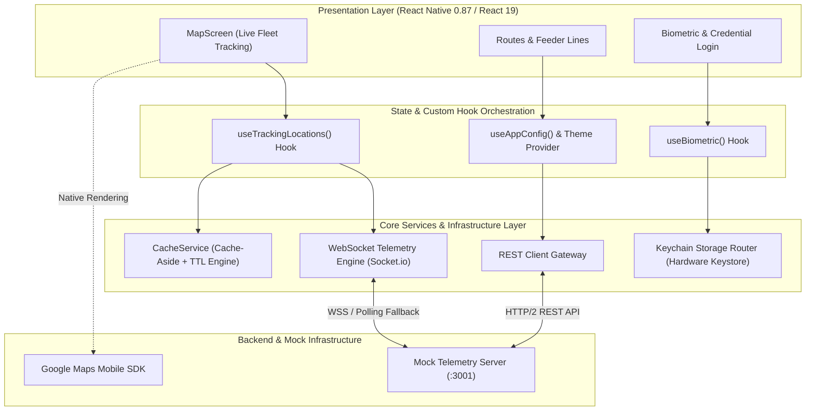
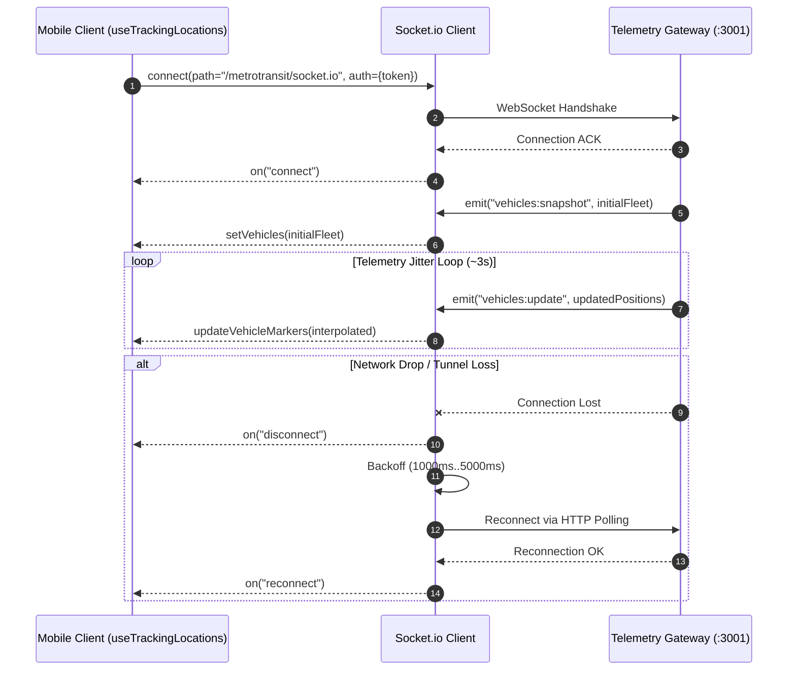
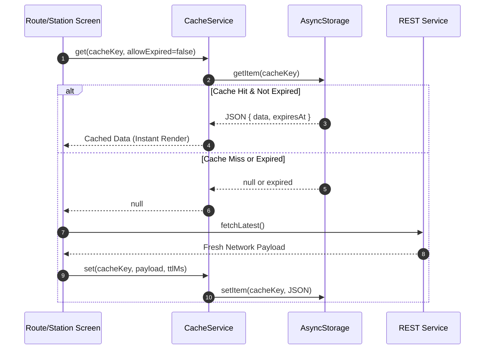

# MetroTransit Mobile — Smart Fleet & Transit Telemetry

> Production-grade React Native 0.87 (React 19 / TypeScript) mobile client engineered for real-time metropolitan fleet telematics, high-frequency geospatial rendering, and hardware-backed biometric security.

---

## Technical Overview & Problem Statement

Urban transit networks require mobile applications capable of digesting high-frequency telemetry streams without exhausting mobile battery life, causing UI frame drops, or exposing user credentials on compromised devices.

**MetroTransit** demonstrates an enterprise mobile architecture solving these engineering challenges through:
1. **Low-Latency Telemetry Streaming:** Persistent WebSocket pipe (`socket.io-client`) with resilient reconnect strategies and transport fallback (`websocket` $\to$ `polling`) to deliver smooth real-time bus tracking.
2. **Cryptographic Tiered Storage:** Hardware-isolated credential security using OS Keystore/Keychains (`react-native-keychain` under `WHEN_UNLOCKED` policies) combined with non-sensitive key-value caching (`AsyncStorage`).
3. **Resilient Offline Cache-Aside Engine:** Centralized caching layer with TTL expiration and automatic corruption recovery.
4. **Decoupled Reactive UI:** Separation of presentation components and business orchestration through customized React hooks.

---

## Architectural Blueprint



---

## Critical Sequence Flows

### 1. High-Frequency Real-Time Vehicle Telemetry


### 2. Cache-Aside Pattern with Time-To-Live (TTL)


---

## Project Structure

```
portfolio-demo-metrotransit-mobile/
├── android/                   # Native Android host project (Kotlin / Gradle)
├── ios/                       # Native iOS host project (Swift / CocoaPods)
├── mock-server/               # Standalone simulated REST API & WebSocket server
│   ├── Dockerfile
│   ├── package.json
│   └── server.js              # Live GPS coordinates broadcaster
├── src/
│   ├── assets/                # Modern slate SVGs and icons
│   ├── components/            # Reusable UI widgets (Map, Markers, Snowfall, Headers)
│   ├── config/                # Central AppConfigContext
│   ├── helpers/               # Secure storage, orientation, date formatters, endpoints
│   ├── hooks/                 # Decoupled custom hooks (useLocation, useAppConfig)
│   ├── navigation/            # Navigation routing & ProtectedScreen guards
│   ├── screens/               # Screen modules (Map, Login, Routes, Support, Splash)
│   ├── shared/                # Cache services, keys, and tracking sockets
│   └── types/                 # Shared TypeScript interfaces
├── docs/
│   ├── ARCHITECTURE.md        # Comprehensive technical architecture deep-dive
│   └── SECURITY.md            # Zero-leakage audit report & MASVS compliance
├── docker-compose.yml         # One-command containerized local backend
├── .env.example               # Documented environment variables template
├── package.json
└── tsconfig.json
```

---

## Environment Variables

Copy `.env.example` to `.env` before building:

```bash
cp .env.example .env
```

| Variable | Description | Default / Demo Value |
| :--- | :--- | :--- |
| `API_BASE_URL` | Base URL for MetroTransit REST services | `http://localhost:3001/v1/` |
| `API_MESSAGES_URL` | Broadcast & System Notifications endpoint | `http://localhost:3001/v1/messages/` |
| `BASE_URL` | Public Base Gateway URL | `http://localhost:3001` |
| `TRACKING_SOCKET_URL` | WebSocket Server URL | `http://localhost:3001` |
| `TRACKING_SOCKET_PATH`| WebSocket mount path | `/metrotransit/socket.io` |
| `GOOGLE_MAPS_API_KEY` | Client-side restricted Google Maps API key | `AIzaSyDUMMY_KEY_FOR_DEMO_PURPOSES_ONLY` |
| `ENABLE_OFFLINE_CACHE`| Toggle for local caching | `true` |
| `DEFAULT_CACHE_TTL_MS`| Cache expiration window in milliseconds | `3600000` (1 hour) |

---

## Quickstart & Local Execution

### 1. Start the Simulated Telemetry Backend
You can run the mock server via Docker or directly with Node:

**Option A — Docker Compose (Recommended):**
```bash
docker compose up -d
```

**Option B — Direct Node execution:**
```bash
npm run mock:server
```

Verify backend health:
```bash
curl http://localhost:3001/health
```

### 2. Install Mobile Dependencies & Run
```bash
# 1. Install NPM packages
npm install

# 2. Start Metro Bundler
npm start

# 3. Launch Android (in a separate terminal)
npm run android

# 4. Launch iOS (requires macOS and CocoaPods installed)
bundle exec pod install --project-directory=ios
npm run ios
```

---

## Security & Disclaimer

> [!IMPORTANT]
> **Reference Architecture & Demo Notice:**  
> This project is a sanitized, architectural reference implementation created strictly for professional portfolio presentation and technical evaluation. All proprietary agency endpoints, real API keys, production certificates, and institutional credentials have been completely purged and replaced with configurable environment placeholders and local mock servers. No live infrastructure or production data is exposed.
