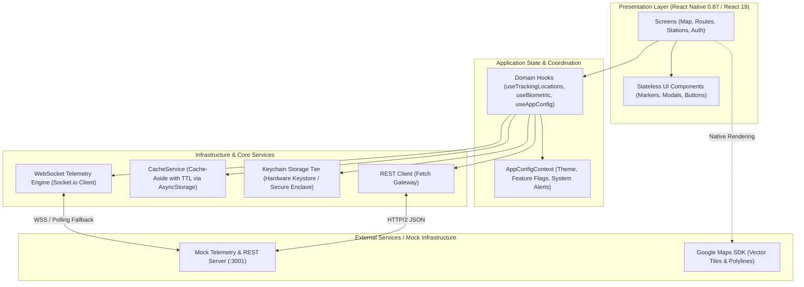
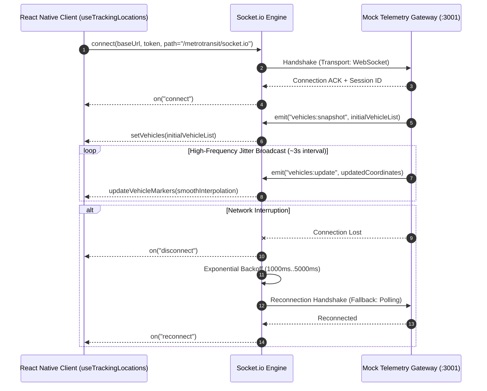
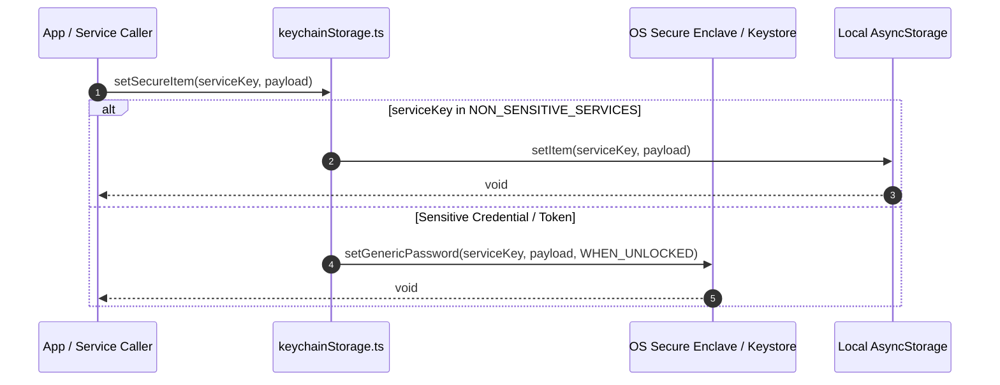
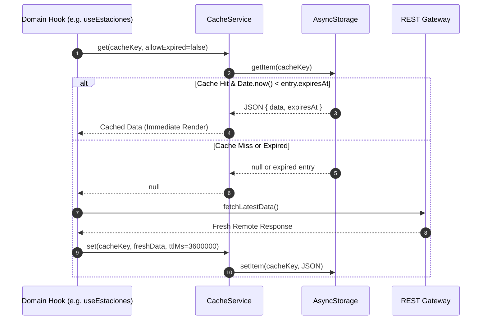

# MetroTransit Architecture Blueprint

This document details the architectural design, patterns, and security guarantees implemented in the **MetroTransit Mobile** reference client.

---

## 1. Architectural Topology

MetroTransit adheres to a decoupled, multi-tiered frontend architecture optimized for low-latency telemetry updates, zero main-thread jank, and cryptographic isolation of sensitive credentials:

---

## 2. Core Architectural Patterns

### 2.1 Real-Time Telemetry Streaming (WebSocket with Reconnection Policy)
Vehicle tracking uses a persistent, event-driven WebSocket pipe managed through `createTrackingSocket`. It features automated reconnection with exponential backoff and transparent transport fallback (`websocket` $\to$ `polling`).

---

### 2.2 Dual-Tier Storage (Cryptographic Keystore vs Local Storage)
To satisfy rigorous cybersecurity benchmarks (OWASP MASVS / Mobile Application Security), MetroTransit segregates data into two distinct tiers:

1. **Hardware-Backed Cryptographic Tier (`react-native-keychain`):**
   - Stores session tokens, JWTs, and biometric unlock flags.
   - Enforces `Keychain.ACCESSIBLE.WHEN_UNLOCKED` (iOS Secure Enclave / Android Keystore Provider).
2. **Non-Sensitive Key-Value Tier (`@react-native-async-storage/async-storage`):**
   - Stores non-sensitive UI preferences (maintenance banners, tutorial completion flags, theme overrides).

---

### 2.3 Cache-Aside Pattern with Time-To-Live (TTL)
The `CacheService` encapsulates offline data retrieval and network request suppression:

---

## 3. Technology Stack & Runtime Specifications

| Category | Component / Library | Specification / Version |
| :--- | :--- | :--- |
| **Framework** | React Native | `0.87.1` (Fabric / New Architecture Enabled) |
| **Runtime Engine** | React / Hermes | React `19.2.3` / Hermes Engine |
| **Language** | TypeScript | `6.0.3` (Strict Mode) |
| **Navigation** | React Navigation | Native Stack `7.21` |
| **Geospatial & Maps** | react-native-maps | `1.29.11` (Google Maps Provider) |
| **Telemetry / Sockets** | socket.io-client | `4.8.4` (WSS / Polling dual mode) |
| **Secure Enclave** | react-native-keychain | `10.0.0` (Hardware Keystore / FaceID / TouchID) |
| **Notifications** | @notifee / @react-native-firebase | Background & Foreground Push Processing |
| **Mock Backend** | Node.js Express / Socket.io | Containerized Mock Telemetry Gateway |
